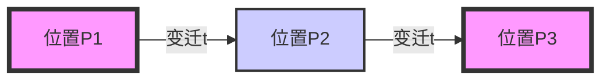

# 基础概念

摘自[Wikipedia](https://zh.wikipedia.org/wiki/%E4%BD%A9%E7%89%B9%E9%87%8C%E7%B6%B2)：

佩特里网（英语：Petri net），又译为裴氏网、派翠网络，是对离散并行系统的数学表示。

佩特里网属于离散事件动态系统，是1960年代由卡尔·亚当·佩特里发明的[1]，适合于描述异步的、并发的计算机系统模型。

佩特里网既有严格的数学表述方式，也有直观的图形表达方式。

 <!--Petri Graph from wikipedia-->

## 构成元素

一个佩特里网由以下几种基本元素构成：

- Place (库所)：表示系统的状态，通常用圆圈表示。
- Transition (变迁)：表示系统中事件的发生，通常用矩形表示。
- Token (标识)：表示系统中的资源或信息，通常用实心圆点表示，放置在库所中。
- Arc (弧)：连接库所和变迁，表示它们之间的关系，通常用有向箭头表示。

## 规则

- Arc为有向的，连接Place和Transition。
- 两个Place或两个Transition之间不能直接连接。
- Place中可以有多个Token。

## 行为

如果一个变迁的每个输入库所（inputplace）都拥有数量足够的令牌时，该变迁即为被允许（enable)。

一个变迁被允许时，变迁将发生（fire)，输入库所（input place）的令牌被消耗，同时为输出库所（output place)产生令牌。

### 注意⚠️

- 变迁只有触发和不触发两种状态，没有进行中状态。
- 变迁的触发是瞬时的。
- 变迁触发后，输入库所的令牌立即被消耗，输出库所的令牌立即被产生。且令牌数目不一定守恒。
- 一次只能触发一个变迁。不存在同时触发多个变迁的情况。若多个变迁均被允许，则只能选择其中一个进行触发，且顺序随机。



## 循环的使用

### For Loop

`For`循环中，*循环变量*在每次迭代后都会更新，直到满足终止条件为止。

```c
for (int i = 0; i < N; i++) {
    // 循环体
}
```

## Latex 公式

$\lim \limits_{x\to \infin}\int_{g(x)}^b \sin (x) dx , \frac 1 x$
